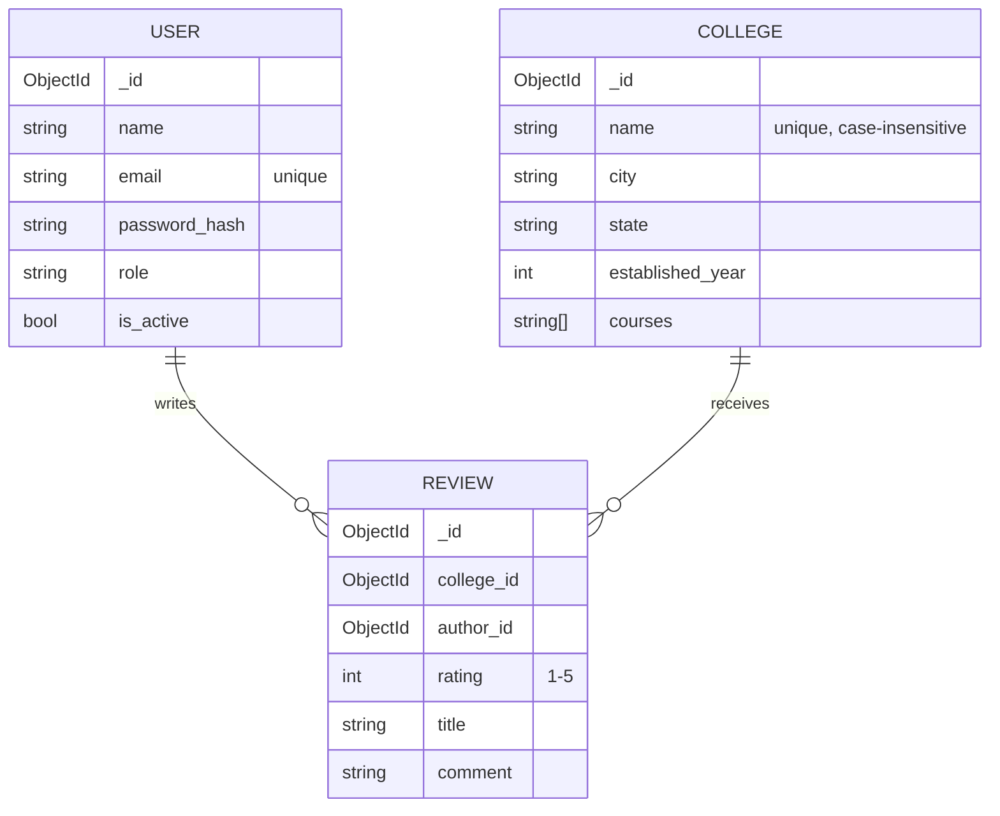
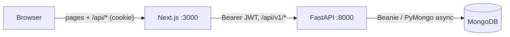

# College Review System

A production-style **College Review** platform: a REST API with JWT authentication, role-based
access (admin / teacher / student), college & review CRUD, pagination, full-text search and
MongoDB aggregation for **average rating + review count per college**, plus a Next.js web app.

| Layer | Technology |
| --- | --- |
| API | **Python 3.12, FastAPI**, Uvicorn |
| Database | **MongoDB 8**, Beanie ODM (on PyMongo's async driver) |
| Auth | **JWT** (PyJWT, HS256) + **bcrypt** password hashing, role-based guards |
| Validation | **Pydantic v2** request/response schemas |
| Tests | **pytest + httpx** (in-process HTTP integration tests against a real MongoDB), pytest-cov |
| Frontend | **Next.js 16** (App Router, TypeScript), **Tailwind CSS v4** |
| Ops | Docker Compose, Dockerfiles, GitHub Actions CI, seed script, Postman + OpenAPI docs |

> **Stack note.** The brief lists Node/Express/Mongoose/Joi/Jest. I chose to build the backend in
> Python with FastAPI, using a direct equivalent for each piece: Express → **FastAPI**,
> Mongoose → **Beanie**, Joi → **Pydantic**, Jest + Supertest → **pytest + httpx**. Everything else
> in the brief is covered as specified (MongoDB, JWT, bcrypt, roles, aggregation, Docker Compose,
> seed script, tests, Postman/Swagger). The setup commands from the brief (`npm install`,
> `npm run seed`, `npm run dev`, `npm test`) work unchanged, because the root `package.json` wraps
> the Python tooling.

---

## Quick start

**Prerequisites:** Node.js ≥ 20.9, Python ≥ 3.12, Docker (for MongoDB).

```bash
git clone <repo-url> college-review-system && cd college-review-system
cp .env.example .env
docker compose up -d        # MongoDB on localhost:27017
npm install                 # also creates backend/.venv and installs Python + frontend deps
npm run seed                # demo users, 12 colleges, ~70 reviews
npm run dev                 # API on :8000 and web app on :3000
npm test                    # 131 integration/unit tests with coverage
```

| URL | What |
| --- | --- |
| http://localhost:3000 | Web app |
| http://localhost:8000/docs | Swagger UI (interactive API docs; click **Authorize** with a token) |
| http://localhost:8000/redoc | ReDoc |
| http://localhost:8000/api/v1/health | Health check (API + database) |

### Seeded accounts

| Role | Email | Password |
| --- | --- | --- |
| Admin | `admin@collegereview.dev` | `Admin@123` |
| Teacher | `priya.teacher@collegereview.dev` | `Password@123` |
| Teacher | `karthik.teacher@collegereview.dev` | `Password@123` |
| Student | `divya@collegereview.dev` (+ 6 more students) | `Password@123` |

The login page also has one-click buttons for these demo accounts.

### Run everything in Docker

```bash
cp .env.example .env
docker compose --profile app up -d --build                     # mongo + api + web
docker compose --profile app run --rm api python -m scripts.seed
```

### Without npm (Python only)

```bash
cd backend
python -m venv .venv && .venv/Scripts/activate      # macOS/Linux: source .venv/bin/activate
pip install -r requirements-dev.txt
python -m scripts.seed
uvicorn app.main:app --reload
pytest --cov
```

No Docker? Any MongoDB works: set `MONGODB_URI` in `.env` (e.g. a free MongoDB Atlas cluster, or a
local `mongod`).

---

## Features

- **Auth**: register (as student or teacher) and login return a JWT. Passwords are bcrypt-hashed
  (12 rounds), emails are normalised, and wrong password vs. unknown email give identical responses
  with equal timing. Login/register are **rate limited** (10/min per IP).
- **Roles**: enforced by FastAPI dependencies; the role is re-read from the DB on every request,
  so promotions and deactivations take effect immediately.
- **Colleges**: CRUD; list with search (name/city/state), state/city filters, minimum rating,
  sorting by name/rating/review count/date and pagination. Every college row includes
  `average_rating` and `review_count`; the detail view adds a 1–5★ **rating distribution**.
- **Reviews**: one per user per college (unique index → `409`), CRUD, pagination, filters
  (college, author, exact/min rating), sorting and **full-text search** (weighted text index on title + comment).
- **Admin**: list/search users, change roles, deactivate accounts; delete any review; delete colleges
  (their reviews are deleted too).
- **Web app**: browse/search colleges, rating summaries, write/edit/delete your review, "My reviews",
  and a management area for teachers/admins (college editor, user roles).

### Permission matrix

| Action | Public | Student | Teacher | Admin |
| --- | :-: | :-: | :-: | :-: |
| Browse colleges & reviews | ✓ | ✓ | ✓ | ✓ |
| Write / edit / delete **own** review | | ✓ | ✓ | ✓ |
| Create & edit colleges | | | ✓ | ✓ |
| Delete colleges (cascades reviews) | | | | ✓ |
| Delete **any** review (moderation) | | | | ✓ |
| Manage users (roles, deactivate) | | | | ✓ |

Nobody, admins included, can edit someone else's review text. Admins can only remove it.
Admin accounts cannot be self-registered (only seeded or promoted), and an admin cannot demote or
deactivate themselves.

---

## API

Base path: `/api/v1`. Full reference: Swagger UI at `/docs`, [`docs/openapi.json`](docs/openapi.json),
or the Postman collection [`docs/postman_collection.json`](docs/postman_collection.json).

| Method | Path | Access | Notes |
| --- | --- | --- | --- |
| `POST` | `/auth/register` | public | `{name, email, password, role?: student\|teacher}` → `201 {access_token, user}` |
| `POST` | `/auth/login` | public | `{email, password}` → `{access_token, token_type, expires_in, user}` |
| `GET` | `/auth/me` | signed in | current user |
| `GET` | `/colleges` | public | `page, limit, search, city, state, min_rating, sort` |
| `POST` | `/colleges` | teacher, admin | `201` |
| `GET` | `/colleges/{id}` | public | + `average_rating`, `review_count`, `rating_distribution` |
| `PATCH` | `/colleges/{id}` | teacher, admin | partial update |
| `DELETE` | `/colleges/{id}` | admin | `204`, deletes the college's reviews |
| `GET` | `/colleges/{id}/reviews` | public | `page, limit, search, min_rating, sort` |
| `GET` | `/reviews` | public | `page, limit, search, college_id, author_id, rating, min_rating, sort` |
| `POST` | `/reviews` | signed in | `{college_id, rating 1-5, title, comment}` → `201`, `409` if already reviewed |
| `GET` | `/reviews/{id}` | public | includes author `{id, name, role}` and college `{id, name}` |
| `PATCH` | `/reviews/{id}` | author | partial update |
| `DELETE` | `/reviews/{id}` | author, admin | `204` |
| `GET` | `/users` | admin | `page, limit, search, role` |
| `GET` / `PATCH` | `/users/{id}` | admin | `PATCH {role?, is_active?}` |
| `GET` | `/health` | public | `200` / `503` with database status |

**Pagination** responses look like:

```json
{
  "data": [{ "id": "…", "name": "IIT Madras", "average_rating": 4.75, "review_count": 4, "…": "…" }],
  "meta": { "page": 1, "limit": 10, "total": 12, "total_pages": 2, "has_next": true, "has_prev": false }
}
```

**Errors** always use one envelope (validation, auth, not found, conflicts, rate limits, 500s):

```json
{
  "error": {
    "code": "VALIDATION_ERROR",
    "message": "Request validation failed",
    "details": [{ "location": "body", "field": "rating", "message": "Input should be less than or equal to 5" }]
  }
}
```

Codes: `VALIDATION_ERROR` 422 · `UNAUTHORIZED` 401 · `FORBIDDEN` 403 · `NOT_FOUND` 404 · `CONFLICT` 409 ·
`RATE_LIMITED` 429 · `INTERNAL_ERROR` 500 (no internals leaked). Request bodies reject unknown fields,
so clients can't set `author_id`, `role`, etc.

---

## Data model & aggregation



| Collection | Indexes |
| --- | --- |
| `users` | `email` unique · `role` |
| `colleges` | `name` unique with case-insensitive collation · `(state, city)` case-insensitive · `created_at` |
| `reviews` | `(college_id, author_id)` **unique** (one review per user per college) · `(college_id, created_at)` · `(author_id, created_at)` · text index on `title` (weight 3) + `comment` |

**Average rating & review count** are computed on read with an aggregation pipeline
(`backend/app/services/college_service.py`):

```js
{ $lookup: { from: "reviews", localField: "_id", foreignField: "college_id",
             pipeline: [{ $group: { _id: null, avg: { $avg: "$rating" }, count: { $sum: 1 } } }],
             as: "_stats" } },
{ $set: { average_rating: { $round: [{ $first: "$_stats.avg" }, 2] },
          review_count:   { $ifNull: [{ $first: "$_stats.count" }, 0] } } },
{ $unset: "_stats" }
```

- The `$lookup` is served by the `reviews.college_id` index.
- Results and total count come from one `$facet` (`data` + `total`) round-trip.
- When sorting by name/date, the pipeline **paginates first** and only aggregates ratings for the
  returned page. Rating sorts and `min_rating` filters compute stats before sorting.
- Unrated colleges get `average_rating: null` (not 0), so they sort last when ordering by rating.
- The detail endpoint groups reviews by star value to build the distribution.

---

## Tests

```bash
npm test                 # or: cd backend && pytest --cov
npm run test:report      # + HTML coverage and JUnit XML in docs/test-results/
```

The tests are integration tests: they call the real FastAPI app over HTTP in-process with httpx
(the Supertest equivalent) against a throw-away MongoDB database, so indexes, aggregations and text
search are exercised for real. They skip with a clear message if MongoDB isn't running.

| Suite | Covers |
| --- | --- |
| `test_auth.py` | register/login, normalisation, duplicate email, validation, generic login errors, expired/forged/orphaned tokens, deactivated users, rate limiting |
| `test_reviews.py` | review CRUD, ownership rules per role, one-per-college conflict, validation, pagination, filters, sorting, full-text search, rating updates across the review lifecycle |
| `test_colleges.py` | college CRUD + RBAC, aggregation correctness (avg/count/distribution/rounding/nulls), every sort, filters, search, pagination, cascade delete |
| `test_users.py` | admin user management, immediate effect of role changes, self-lockout protection |
| `test_app.py` | health (up/down), lifespan, error envelope, 404/405/malformed JSON, CORS, security headers, request IDs, generic 500, password hashing, JWT and settings units |

**Latest run:** 131 passed, **99% line + branch coverage** (`docs/test-results/`):
[`pytest-output.txt`](docs/test-results/pytest-output.txt) · [`junit.xml`](docs/test-results/junit.xml) ·
[`coverage-html/index.html`](docs/test-results/coverage-html/index.html) ·
[`postman-newman.txt`](docs/test-results/postman-newman.txt) (Postman collection: 28 requests, 30 assertions, 0 failures).

---

## Frontend architecture

The browser never holds the JWT. Next.js route handlers (`frontend/src/app/api`) act as a
backend-for-frontend: login stores the token in an **httpOnly, SameSite=Lax** cookie, and
`/api/backend/*` proxies to the API, adding the `Authorization` header. Cross-site writes are
rejected with an Origin check. Public pages are Server Components that stream data behind
`<Suspense>`; forms and the admin area are Client Components. See [`frontend/README.md`](frontend/README.md).



## Project structure

```
college-review-system/
├── backend/
│   ├── app/
│   │   ├── api/            routes (auth, colleges, reviews, users, health) + deps (auth, roles, pagination)
│   │   ├── core/           config, database, security (JWT/bcrypt), errors, middleware, rate limit
│   │   ├── models/         Beanie documents + indexes
│   │   ├── schemas/        Pydantic request/response models
│   │   ├── services/       business logic & aggregation pipelines
│   │   └── main.py         app factory
│   ├── scripts/seed.py     demo data
│   ├── tests/              pytest suites
│   └── Dockerfile
├── frontend/               Next.js app (see frontend/README.md)
├── docs/                   openapi.json, postman_collection.json, test-results/
├── scripts/                npm → Python helpers (setup, py runner, Postman generator)
├── docker-compose.yml
├── .env.example
└── PRODUCTION_READINESS.md
```

## Production readiness

See [`PRODUCTION_READINESS.md`](PRODUCTION_READINESS.md) for what is already in place and what I would add before a real launch.

## Troubleshooting

- **`MongoDB is not reachable` when running tests**: start it with `docker compose up -d`, or point
  `MONGODB_URI` / `TEST_MONGODB_URI` at another instance.
- **`Python virtualenv not found`**: run `npm install` (or `npm run setup`) from the project root.
- **Port already in use**: change `MONGO_PORT` in `.env` for MongoDB, or stop the process using
  `3000`/`8000`.
